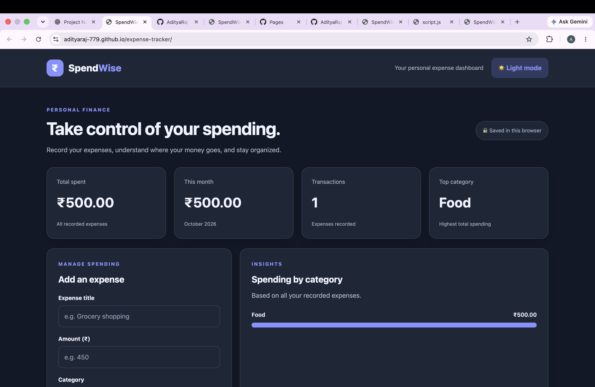

 # 💰 SpendWise — Personal Expense Tracker

A responsive personal expense tracker built using **HTML, CSS, and JavaScript**. SpendWise helps users record daily expenses, monitor spending, and manage their finances through a simple dashboard.

## 🌐 Live Demo

**Website:** https://adityaraj-779.github.io/expense-tracker/

## 📸 Project Screenshot



## ✨ Features

- Add, edit, and delete expenses
- Track total and monthly spending
- View spending by category
- Filter and sort expense history
- Light and dark mode
- Export expenses to CSV
- Save expenses using browser local storage
- Responsive user interface

## 🛠️ Technologies Used

- **HTML5** — Website structure
- **CSS3** — Styling and responsive design
- **JavaScript** — Expense management and calculations
- **LocalStorage** — Browser-based data persistence
- **Git & GitHub** — Version control
- **GitHub Pages** — Website deployment

## 📁 Project Structure

```text
expense_tracker/
├── index.html
├── style.css
├── script.js
└── README.md
```

## 🚀 How to Run Locally

1. Download or clone the repository.
2. Open the project folder in VS Code.
3. Open `index.html` in your browser.
4. Start tracking your expenses.

## 📌 Important Note

Expenses are stored locally in the user's browser. Data is not synchronized between devices, and clearing browser storage may delete saved expenses.

## 👨‍💻 Developer

**Aditya Raj**

GitHub: https://github.com/AdityaRaj-779

## 📄 Project Status

Completed and deployed successfully using GitHub Pages.
